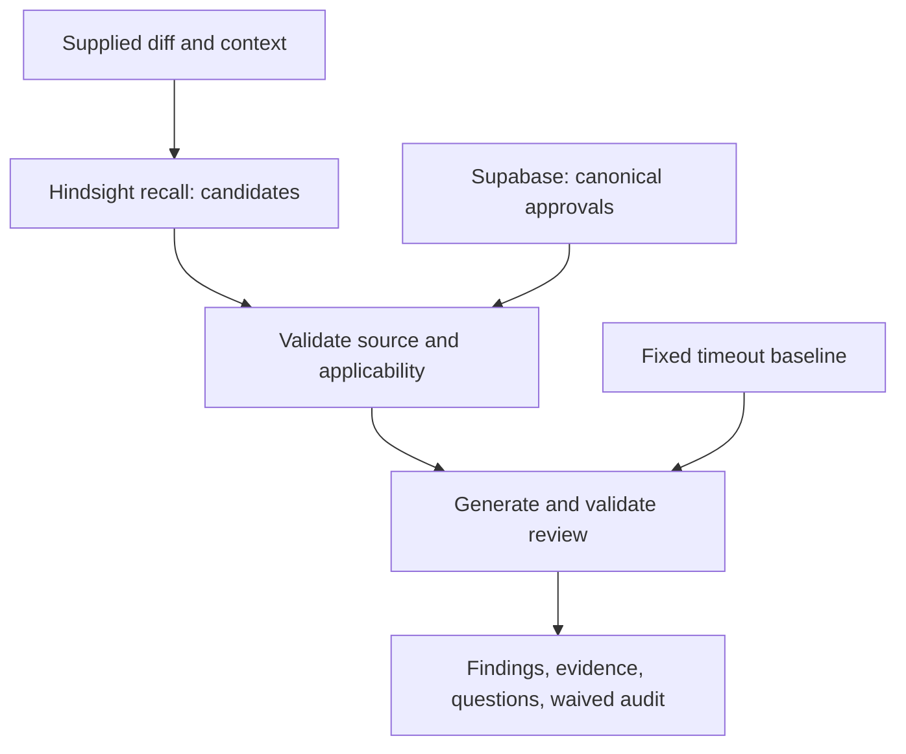

# ReviewMind LinkedIn visual brief

Status: design brief only. No image or screenshot has been created. The React UI exists in source, but no browser-verified screenshot or successful live memory result was available during this review.

## Recommended current visual

Create one 1200 x 1200 conceptual diagram. This size is a design choice, not a quoted platform requirement. Label it prominently **ReviewMind design** and **Live integration verification pending**. Do not style it as a screenshot of completed application output.

Headline: **Approved before. Does it still apply?**

Use a light #F5F7FB background, white cards, #172B4D text, and #2563EB arrows. Keep a 64 px safe margin and comfortably legible type. Use labels and simple icons rather than color alone. Do not use vendor logos without an appropriate supplied asset.

Diagram layout:

1. Top card: **Supplied code diff**.
2. Second card: **Hindsight recall — candidate history**.
3. Third card, visually central: **Check the decision**. Include approval/source, path, dependency version, and expiry.
4. Side card connected to the checking step: **Supabase — canonical approval record**.
5. Bottom card: **Review with evidence or an explicit question**.
6. Small baseline strip: **A wrapper exception cannot waive the timeout**.

Footer: **52 local tests passed · Provider proof pending**. Do not add accuracy scores, success ticks for live operations, fake source IDs, simulated provider traces, or a working-demo claim.

Alt text:

“Conceptual ReviewMind architecture. A supplied code diff leads to Hindsight recall, then checks against canonical approval records for source, path, dependency version, and expiry before a review uses the evidence. A separate timeout baseline remains mandatory. The diagram labels live integration verification as pending.”

## Article diagram source

This is a description of implemented routing and intended integration behavior, not a run trace. Render/export it before inserting into an article if the publishing platform does not render Mermaid.

## Genuine screenshot after live verification

Once the actual browser learning loop succeeds, capture the diff alongside its source card. Keep the visible synthetic-data label and exclude keys, account details, unrelated tabs, and internal prompts. A later montage may show three separate recorded states: **applies here**, **wrong path**, and **expired**, with matching run IDs retained privately for audit. Preserve the timeout finding in the appropriate counterexample. Do not manufacture those states in an image editor.

For the current article, a genuine test-terminal screenshot may illustrate the 52 local checks. Label it **Local deterministic and PGlite tests — no external provider calls**. It does not replace the required live learning demonstration.
